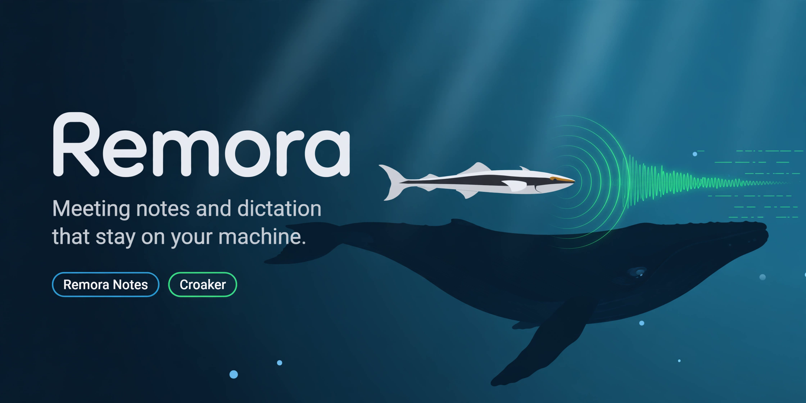

<p align="center">
  
</p>

<p align="center">
  
  
  
  
</p>

Remora is a local-first desktop app with two modules:

- **Remora Notes**: records mic and system audio without a bot joining the call. It works out who said what and merges your rough notes with the transcript into clean meeting notes.
- **Croaker**: system-wide dictation. Hold a hotkey, speak, and polished text is typed into whichever app has focus.

All recordings, transcripts and notes are stored as local files on your machine. Nothing is synced to the cloud.

## Download

Get the Windows installer: [`Remora_0.1.0_x64-setup.exe`](Remora_0.1.0_x64-setup.exe)

The installer is unsigned, so Windows SmartScreen may show a warning. Choose **More info → Run anyway**.

## Default shortcuts

| Action | Windows | macOS |
|---|---|---|
| Dictate (Croaker) | `Ctrl+Alt+Space` | `Option+Space` |
| Start/stop meeting | `Ctrl+Shift+M` | `Cmd+Shift+M` |

You can change both in **Settings**.

## AI providers

Speech-to-text runs on your device. Cleanup, summaries and translation use the LLM provider you choose:

- **Cloud**: Anthropic Claude (default), OpenAI, Groq, OpenRouter
- **Local**: Ollama (`localhost:11434`), LM Studio (`localhost:1234`)

API keys are stored in the OS keychain (Windows Credential Manager or macOS Keychain).

## Build from source

Prerequisites: [Node.js](https://nodejs.org/) 20+, [Rust](https://rustup.rs/) (stable), and the [Tauri 2 prerequisites](https://v2.tauri.app/start/prerequisites/) for your OS.

```powershell
npm install
npx tauri dev      # run in development mode
npx tauri build    # build the installer into src-tauri/target/release/bundle/
```

Run type checks and tests:

```powershell
npx tsc --noEmit
node --test tests/
```

## Tech stack

- **Shell**: Tauri 2 (Rust)
- **UI**: React 19, TypeScript, Vite
- **Audio**: `cpal` for mic and system-audio capture
- **Speech**: `whisper-rs` and `sherpa-rs` for transcription and speaker recognition
- **Text insertion**: `enigo`

## Data location

| OS | Path |
|---|---|
| Windows | `%LOCALAPPDATA%\Remora\data` |

## License

[MIT](LICENSE) © 2026 Akash Gunasekar
